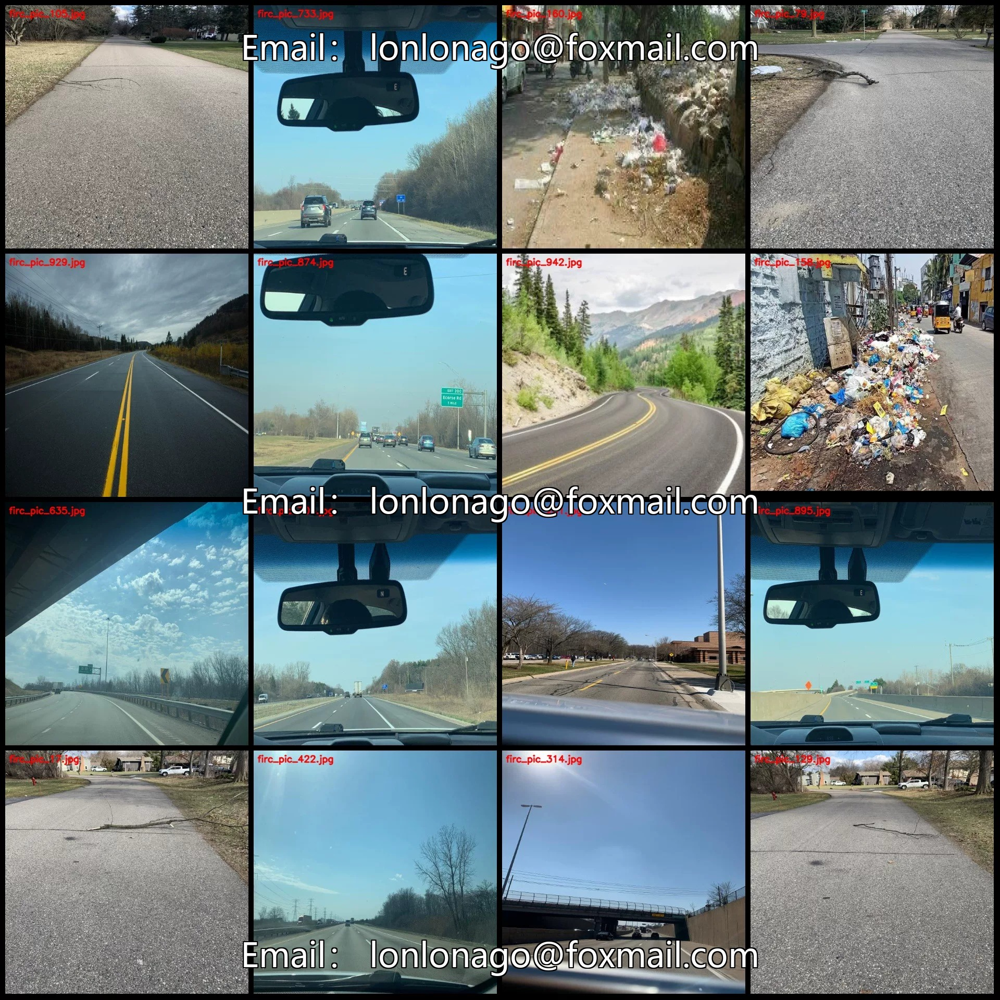
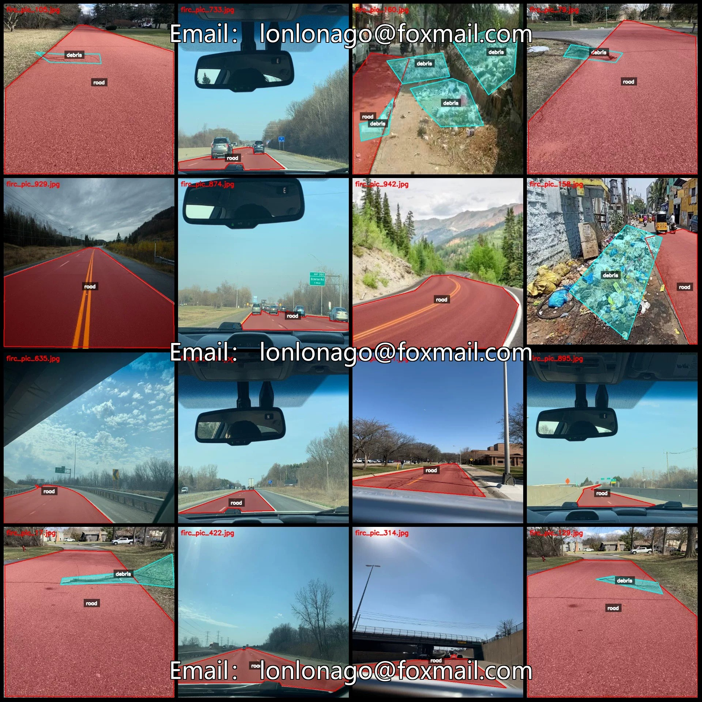
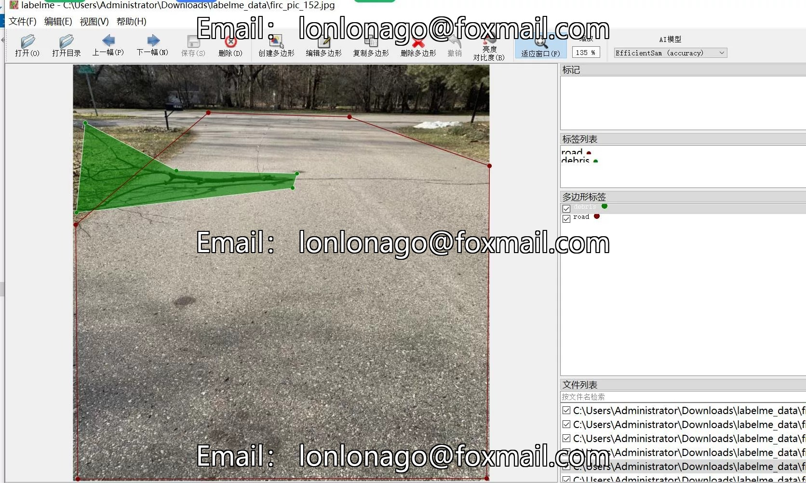
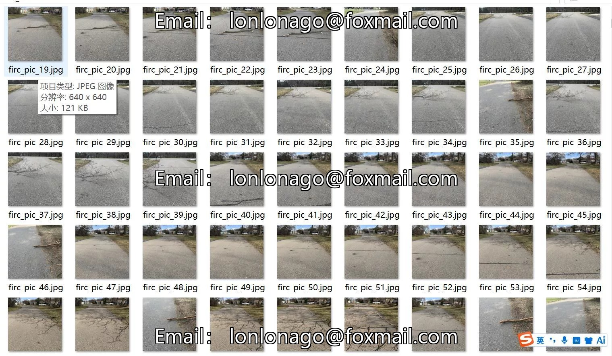
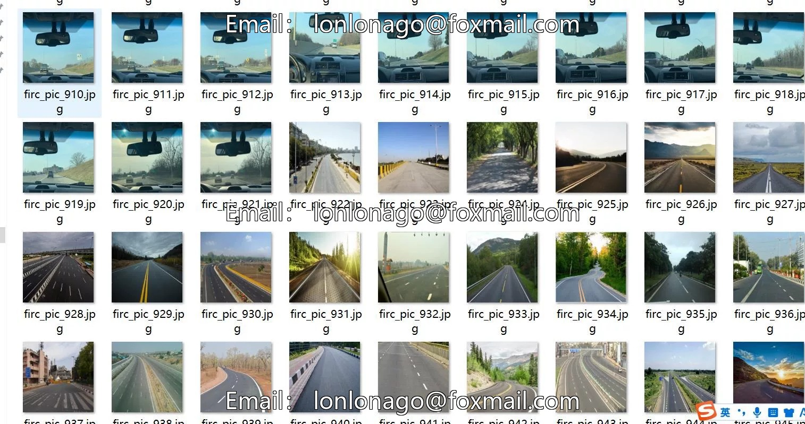
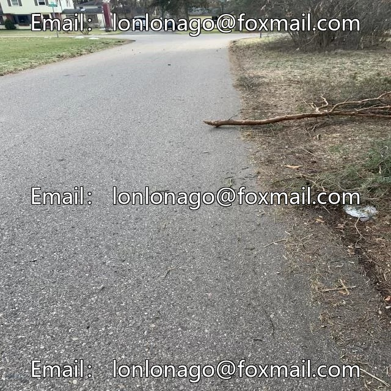
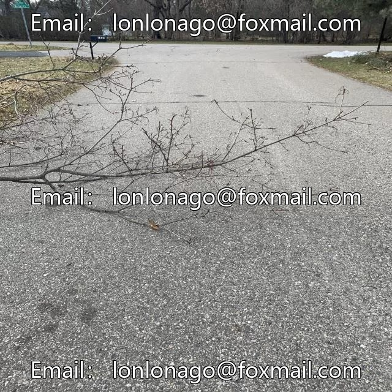

# Road Obstacle Identification and Segmentation Dataset - LabelMe format: 1002 images, 2 classes

## Body

Road Obstacle Identification and Segmentation Dataset - LabelMe Format: 1002 Images, 2 Categories

Warm Reminder: Due to the dataset's replicability, please confirm compliance with requirements before purchasing.

Dataset Format: LabelMe format (excluding mask files, only including jpg images and corresponding json files)
Number of Images (Total Number of JPG Files): 1002
Number of Annotations (Total Number of JSON Files): 1002
Number of Annotation Categories: 2
Annotation Category Names: ["debris", "road"]

Each category has its own number of bounding boxes and image counts:
- For "debris": 265 bounding boxes, 202 images
- For "road": 1059 bounding boxes, 1001 images

Total number of frames: 1324
Using labeling tool: labelme=5.5.0
Image resolution: 640x640
Labeling rules: Polygons are drawn around the categories.
Important note: The dataset can be opened and edited using labelme, but JSON datasets must be converted into either mask or Yolo format for semantic segmentation or instance segmentation.
Special declaration: This dataset does not guarantee any accuracy in the trained models or weight files.

## Images

## Payment

Here is a pay link on Stripe ( https://buy.stripe.com/3cs8yP7sY87d0vu9AB ). Please contact me lonlonago@foxmail.com after funding $89, and I will send you a complete data files , thank you!

